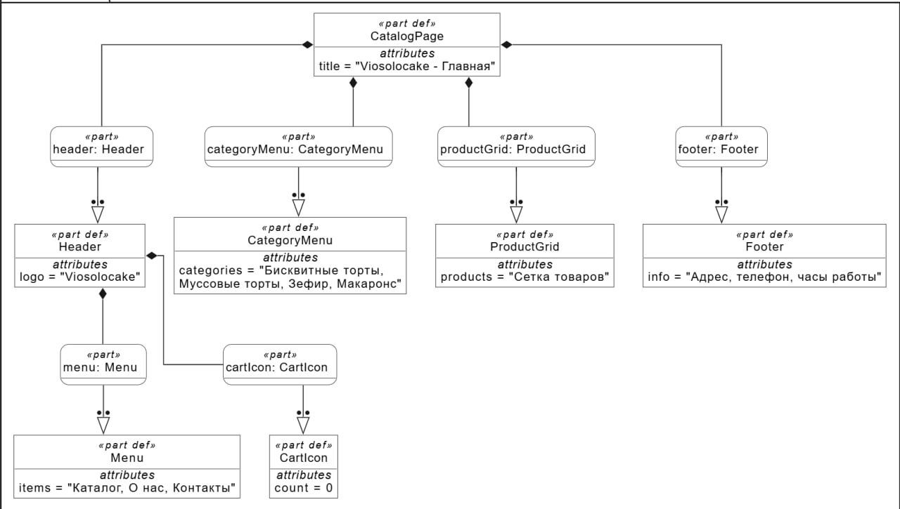
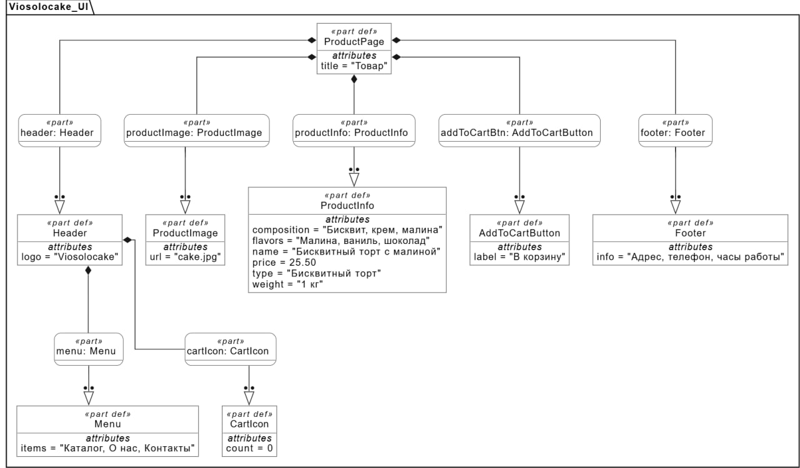
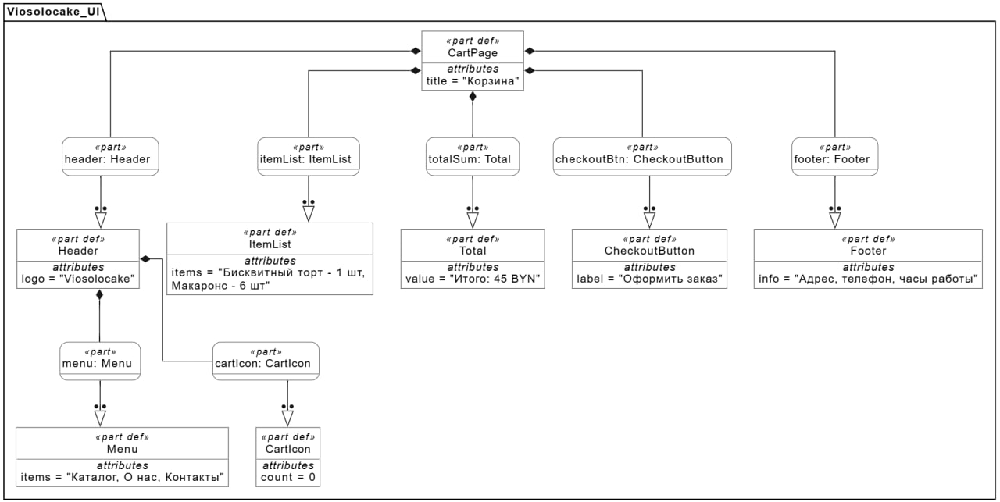
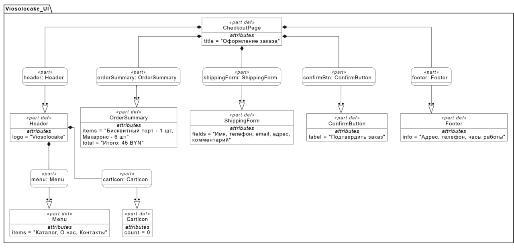

# Спецификация требований к ПО

Для интернет-магазина кондитерских изделий

Версия 0.3

Подготовила Солонович Виолетта Сергеевна

БГУИР

30.10.2026

## Оглавление

<!-- TOC -->
* [1. Введение](#1-introduction)
  * [1.1 Назначение документа](#11-document-purpose)
  * [1.2 Область применения продукта](#12-product-scope)
  * [1.3 Определения, акронимы и сокращения](#13-definitions-acronyms-and-abbreviations)
  * [1.4 Ссылки](#14-references)
  * [1.5 Обзор документа](#15-document-overview)
* [2. Обзор продукта](#2-product-overview)
  * [2.1 Перспектива продукта](#21-product-perspective)
  * [2.2 Функции продукта](#22-product-functions)
  * [2.3 Ограничения продукта](#23-product-constraints)
  * [2.4 Характеристики пользователей](#24-user-characteristics)
  * [2.5 Допущения и зависимости](#25-assumptions-and-dependencies)
  * [2.6 Распределение требований](#26-apportioning-of-requirements)
* [3. Требования](#3-requirements)
  * [3.1 Внешние интерфейсы](#31-external-interfaces)
  * [3.2 Функциональные требования](#32-functional)
  * [3.3 Качество обслуживания](#33-quality-of-service)
  * [3.4 Соответствие стандартам](#34-compliance)
  * [3.5 Проектирование и реализация](#35-design-and-implementation)
* [4. Верификация](#4-verification)
* [5. Приложения](#5-appendixes)
<!-- TOC -->

## История изменений

| Name | Date | Reason For Changes | Version |
|------|------|--------------------|---------|
| Солонович В.С. | 13.10.2026 | Первоначальная версия | 0.1 |
| Солонович В.С. | 13.10.2026 | Уточнены категории товаров, добавлены структурные диаграммы | 0.2 |
| Солонович В.С. | 30.10.2026 | Добавлено требование системы лояльности, личный кабинет в статусе Deferred | 0.3 |

---

## 1. Введение {#1-introduction}

### 1.1 Назначение документа {#11-document-purpose}

Настоящий документ описывает требования к веб-приложению — интернет-магазину кондитерских изделий с доставкой. SRS определяет **ЧТО** должна делать система, а не **КАК** она будет реализована.

Документ предназначен для:
- продуктовой команды — для понимания целей и границ проекта;
- разработчиков — для проектирования и реализации;
- QA-инженеров — для составления тест-кейсов;
- заказчика — для приёмки результата.

### 1.2 Область применения продукта {#12-product-scope}

Разрабатываемое веб-приложение предназначено для продажи кондитерских изделий (бисквитные торты, муссовые торты, зефир, макаронс) с возможностью оформления заказа и доставки по городу.

**Входит в область:**
- каталог товаров с категориями;
- поиск и фильтры по вкусу и цене;
- корзина и оформление заказа;
- информация о кондитерской;
- доставка;
- админ-панель для просмотра заказов;
- система лояльности (начисление бонусов).

**Не входит в область:**
- мобильное приложение (только Web);
- доставка за пределы города;
- онлайн-оплата на сайте (оплата производится при получении или по договорённости);
- полноценный личный кабинет и история заказов (перенесено в релиз 2.0).

### 1.3 Определения, акронимы и сокращения {#13-definitions-acronyms-and-abbreviations}

| Term | Definition |
|------|------------|
| API | Application Programming Interface — набор определений и протоколов для интеграции ПО |
| SRS | Software Requirements Specification — документ, описывающий требования к ПО |
| UI | User Interface — визуальная часть приложения |
| HTTPS | HyperText Transfer Protocol Secure — защищённый протокол передачи данных |
| SPA | Single Page Application — одностраничное веб-приложение |
| БД | База данных |

### 1.4 Ссылки {#14-references}

| Название | Автор/Владелец | Версия | Дата | Тип |
|----------|----------------|--------|------|-----|
| ISO/IEC/IEEE 29148:2018 | ISO/IEC/IEEE | 2018 | 2018 | Нормативная |
| IEEE 830-1998 | IEEE | 1998 | 1998 | Справочная |
| Закон РБ «О защите персональных данных» | РБ | — | 2021 | Нормативная |

### 1.5 Обзор документа {#15-document-overview}

Документ состоит из 5 разделов. Раздел 1 — введение. Раздел 2 — обзор продукта. Раздел 3 — требования. Раздел 4 — верификация. Раздел 5 — приложения. Все требования имеют уникальные ID формата `REQ-[AREA]-[NNN]`.

---

## 2. Обзор продукта {#2-product-overview}

### 2.1 Перспектива продукта {#21-product-perspective}

Разрабатываемый интернет-магазин является новым каналом продаж для кондитерской. Ранее Заказчик принимал заказы только по телефону и через соцсети. Приложение должно автоматизировать приём заказов и расширить аудиторию.

**Внешние системы:**
- сервис доставки (Яндекс.Доставка / Белпочта);
- SMTP-сервер для email-уведомлений.

### 2.2 Функции продукта {#22-product-functions}

- Просмотр каталога по категориям.
- Поиск и фильтрация товаров по вкусу и цене.
- Карточка товара с фото, ценой, составом.
- Корзина.
- Оформление заказа без онлайн-оплаты.
- Информация о кондитерской.
- Доставка.
- Админ-панель для просмотра товаров и заказов.
- Система лояльности (бонусы).

### 2.3 Ограничения продукта {#23-product-constraints}

- Только Web-версия.
- Русский язык интерфейса.
- Оплата на сайте не производится — только оформление заказа.
- Доставка только по городу.
- Соответствие законодательству о защите персональных данных.

### 2.4 Характеристики пользователей {#24-user-characteristics}

| Роль | Описание | Права |
|------|----------|-------|
| Покупатель | Клиент кондитерской | Просмотр, заказ, получение бонусов |
| Администратор | Сотрудник магазина | Управление товарами, просмотр заказов |
| Кондитер | Сотрудник производства | Просмотр состава заказов |
| Курьер | Сотрудник доставки | Просмотр адресов доставки |

### 2.5 Допущения и зависимости {#25-assumptions-and-dependencies}

- Пользователи имеют современные браузеры.
- Внешний API доставки возвращает корректные данные.
- Хостинг обеспечивает доступность 99%.

### 2.6 Распределение требований {#26-apportioning-of-requirements}

| Компонент | Требования |
|-----------|-----------|
| Каталог | REQ-FUNC-001, REQ-FUNC-002, REQ-FUNC-003 |
| Корзина | REQ-FUNC-004, REQ-FUNC-005 |
| Оформление | REQ-FUNC-006 |
| Админ-панель | REQ-FUNC-009 |
| Уведомления | REQ-FUNC-010 |
| Лояльность | REQ-FUNC-014 |

---

## 3. Требования {#3-requirements}

### 3.1 Внешние интерфейсы {#31-external-interfaces}

#### 3.1.1 Пользовательские интерфейсы {#311-user-interfaces}

- **REQ-INT-001:** Система должна предоставлять главную страницу с каталогом товаров, разбитым по категориям (бисквитные торты, муссовые торты, зефир, макаронс).
- **REQ-INT-002:** Система должна предоставлять карточку товара с фотографией, названием, ценой, составом, весом и кнопкой «В корзину».
- **REQ-INT-003:** Система должна предоставлять корзину с возможностью изменения количества товаров.
- **REQ-INT-004:** Система должна предоставлять страницу оформления заказа с формой адреса доставки и контактных данных.
- **REQ-INT-005:** Система должна предоставлять страницу личного кабинета с историей заказов. **(Deferred)**
- **REQ-INT-006:** Система должна предоставлять страницу с информацией о кондитерской (адрес, телефон, часы работы, история).

#### 3.1.2 Аппаратные интерфейсы {#312-hardware-interfaces}

- **REQ-INT-007:** Система должна корректно работать на устройствах с разрешением от 320px до 2560px.
- **REQ-INT-008:** Система должна поддерживать ввод данных с клавиатуры, мыши и touch-ввод на мобильных устройствах.

#### 3.1.3 Программные интерфейсы {#313-software-interfaces}

- **REQ-INT-009:** Система должна интегрироваться с сервисом доставки для расчёта стоимости и оформления доставки.
- **REQ-INT-010:** Система должна отправлять email-уведомления через SMTP-сервер.
- **REQ-INT-011:** Система должна предоставлять REST API для взаимодействия frontend и backend.

### 3.2 Функциональные требования {#32-functional}

- **REQ-FUNC-001:** Система должна отображать каталог товаров, разбитый по категориям: бисквитные торты, муссовые торты, зефир, макаронс.
- **REQ-FUNC-002:** Система должна предоставлять поиск по названию товара.
- **REQ-FUNC-003:** Система должна предоставлять фильтрацию товаров по цене и по вкусу (шоколад, ваниль, фрукты, ягоды и т.д.).
- **REQ-FUNC-004:** Система должна позволять добавлять товар в корзину.
- **REQ-FUNC-005:** Система должна позволять изменять количество товара в корзине и удалять товар.
- **REQ-FUNC-006:** Система должна позволять оформлять заказ с указанием адреса доставки и контактных данных. Оплата на сайте не производится.
- **REQ-FUNC-007:** Система должна позволять регистрироваться и входить в личный кабинет. **(Deferred)**
- **REQ-FUNC-008:** Система должна отображать историю заказов пользователя в личном кабинете. **(Deferred)**
- **REQ-FUNC-009:** Система должна предоставлять администратору панель для управления товарами (добавление, редактирование, удаление) и просмотра заказов.
- **REQ-FUNC-010:** Система должна отправлять email-уведомление пользователю о статусе заказа.
- **REQ-FUNC-011:** Система должна отображать информацию о кондитерской: адрес, телефон, часы работы, историю.
- **REQ-FUNC-012:** Система должна рассчитывать стоимость доставки в зависимости от адреса.
- **REQ-FUNC-013:** Система должна позволять пользователю выходить из личного кабинета. **(Deferred)**
- **REQ-FUNC-014:** Система должна начислять бонусы пользователям за совершенные покупки (Система лояльности).

### 3.3 Качество обслуживания {#33-quality-of-service}

#### 3.3.1 Производительность {#331-performance}

- **REQ-PERF-001:** Время загрузки главной страницы не должно превышать 2 секунд при скорости соединения 10 Мбит/с.
- **REQ-PERF-002:** Время отклика API при типовом запросе не должно превышать 500 мс.
- **REQ-PERF-003:** Система должна выдерживать не менее 100 одновременных пользователей без деградации.

#### 3.3.2 Безопасность {#332-security}

- **REQ-SEC-001:** Все данные между клиентом и сервером должны передаваться по HTTPS.
- **REQ-SEC-002:** Пароли пользователей должны храниться в хешированном виде (bcrypt или аналог).
- **REQ-SEC-003:** Система должна защищать от SQL-инъекций, XSS и CSRF.
- **REQ-SEC-004:** Доступ к админ-панели должен быть ограничен ролью администратора.

#### 3.3.3 Надёжность {#333-reliability}

- **REQ-REL-001:** При сбое отправки email-уведомления заказ должен сохраняться, а ошибка — логироваться.
- **REQ-REL-002:** Система должна выполнять резервное копирование БД не реже 1 раза в сутки.

#### 3.3.4 Доступность {#334-availability}

- **REQ-AVAIL-001:** Доступность системы должна быть не менее 99% в месяц.
- **REQ-AVAIL-002:** Плановые технические работы должны проводиться в ночное время (с 02:00 до 05:00).

#### 3.3.5 Наблюдаемость {#335-observability}

- **REQ-OBS-001:** Система должна вести логи всех ошибок и критических событий.
- **REQ-OBS-002:** Система должна собирать статистику: количество оформленных заказов, количество зарегистрированных пользователей, количество ошибок.
- **REQ-OBS-003:** Логи не должны содержать персональные данные пользователей в открытом виде.

### 3.4 Соответствие стандартам {#34-compliance}

- **REQ-COMP-001:** Система должна соответствовать ISO/IEC/IEEE 29148:2018.
- **REQ-COMP-002:** Система должна соответствовать законодательству РБ о защите персональных данных.
- **REQ-COMP-003:** Система должна соответствовать стандарту WCAG 2.1 уровня AA по доступности.

### 3.5 Проектирование и реализация {#35-design-and-implementation}

#### 3.5.1 Установка {#351-installation}

- **REQ-INST-001:** Система должна разворачиваться на виртуальном сервере (VPS).
- **REQ-INST-002:** Развёртывание должно автоматизироваться.

#### 3.5.2 Сборка и поставка {#352-build-and-delivery}

- **REQ-BUILD-001:** Сборка frontend — через Vite.
- **REQ-BUILD-002:** Backend — Java Spring Boot, сборка через Maven.
- **REQ-BUILD-003:** CI/CD через GitHub Actions.

#### 3.5.3 Распределение {#353-distribution}

- **REQ-DIST-001:** Frontend и backend разворачиваются на одном сервере.
- **REQ-DIST-002:** БД PostgreSQL разворачивается на том же сервере.

#### 3.5.4 Сопровождаемость {#354-maintainability}

- **REQ-MAINT-001:** Код должен быть покрыт тестами не менее чем на 60%.
- **REQ-MAINT-002:** Код должен соответствовать ESLint-правилам.

#### 3.5.5 Повторное использование {#355-reusability}

- **REQ-REUSE-001:** Компоненты UI должны быть переиспользуемыми (React-компоненты).

#### 3.5.6 Переносимость {#356-portability}

- **REQ-PORT-001:** Система должна работать в браузерах Chrome, Firefox, Safari, Edge последних версий.

#### 3.5.7 Стоимость {#357-cost}

- **REQ-COST-001:** Стоимость хостинга не должна превышать 20 USD в месяц.

#### 3.5.8 Сроки {#358-deadline}

- **REQ-DEAD-001:** MVP должен быть готов в течение 3 месяцев.

#### 3.5.9 Доказательство концепции {#359-proof-of-concept}

- **REQ-POC-001:** Прототип каталога и корзины должен быть проверен до начала основной разработки.

#### 3.5.10 Управление изменениями {#3510-change-management}

- **REQ-CM-001:** Все изменения требований должны фиксироваться в истории изменений SRS.
- **REQ-CM-002:** Изменения должны проходить через Pull Request.

---

## 4. Верификация {#4-verification}

| Requirement ID | Verification Method | Test/Artifact Link | Status | Evidence |
|----------------|---------------------|--------------------|--------|----------|
| REQ-FUNC-001 | Test | tests/catalog.md | WIP | |
| REQ-FUNC-002 | Test | tests/search.md | WIP | |
| REQ-FUNC-003 | Test | tests/filter.md | WIP | |
| REQ-FUNC-004 | Test | tests/cart-add.md | WIP | |
| REQ-FUNC-005 | Test | tests/cart-modify.md | WIP | |
| REQ-FUNC-006 | Test | tests/order.md | WIP | |
| REQ-FUNC-007 | Test | tests/auth.md | **Deferred** | |
| REQ-FUNC-008 | Test | tests/history.md | **Deferred** | |
| REQ-FUNC-009 | Test | tests/admin-orders.md | WIP | |
| REQ-FUNC-010 | Test | tests/email-notify.md | WIP | |
| REQ-FUNC-011 | Inspection | — | WIP | |
| REQ-FUNC-012 | Test | tests/delivery-calc.md | WIP | |
| REQ-FUNC-013 | Test | tests/logout.md | **Deferred** | |
| REQ-FUNC-014 | Test | tests/loyalty-bonus.md | WIP | |
| REQ-INT-001 | Inspection | — | WIP | |
| REQ-INT-002 | Inspection | — | WIP | |
| REQ-INT-003 | Inspection | — | WIP | |
| REQ-INT-004 | Inspection | — | WIP | |
| REQ-INT-005 | Inspection | — | **Deferred** | |
| REQ-INT-006 | Inspection | — | WIP | |
| REQ-INT-007 | Test | tests/responsive.md | WIP | |
| REQ-INT-008 | Test | tests/touch-input.md | WIP | |
| REQ-INT-009 | Test | tests/delivery-api.md | WIP | |
| REQ-INT-010 | Test | tests/smtp.md | WIP | |
| REQ-INT-011 | Inspection | — | WIP | |
| REQ-PERF-001 | Test | tests/performance.md | WIP | |
| REQ-PERF-002 | Test | tests/api-performance.md | WIP | |
| REQ-SEC-001 | Inspection | — | WIP | |
| REQ-SEC-002 | Inspection | — | WIP | |
| REQ-SEC-003 | Analysis | — | WIP | |
| REQ-SEC-004 | Test | tests/admin-access.md | WIP | |
| REQ-REL-001 | Analysis | — | WIP | |
| REQ-REL-002 | Analysis | — | WIP | |
| REQ-AVAIL-001 | Analysis | — | WIP | |
| REQ-OBS-001 | Test | tests/logs.md | WIP | |
| REQ-COMP-002 | Analysis | — | WIP | |
| REQ-INST-001 | Inspection | — | WIP | |
| REQ-MAINT-001 | Analysis | — | WIP | |
| REQ-PORT-001 | Test | tests/browsers.md | WIP | |

---

## 5. Приложения {#5-appendixes}

### 5.1 Структурные диаграммы интерфейса (SysML v2)

**Структура главной страницы (Каталог):**

**Структура карточки товара:**

**Структура корзины:**

**Структура оформления заказа:**

### 5.2 Ссылки на артефакты

- Репозиторий:(https://github.com/viosolo/SDLC)
- Структурные диаграммы SysML v2: srs/images/
- ADR: adr/
- SDD: sdd/
